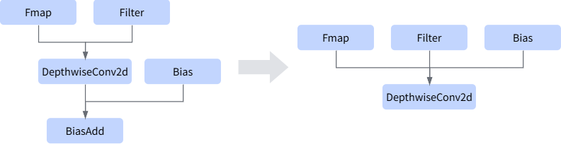
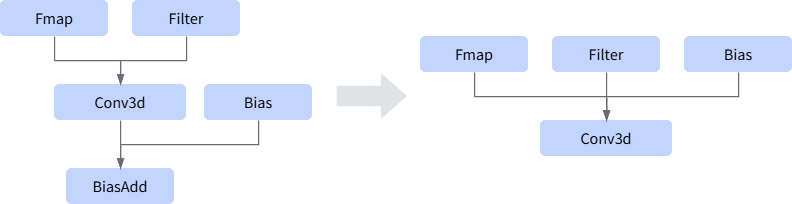
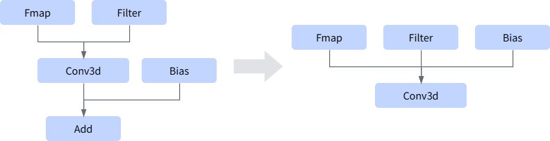

# AABiasaddConvFusion

## Fusion Pattern

This fusion rule fuses the Conv convolution operator that does not contain Bias and the BiasAdd operator into a Conv convolution operator that contains a Bias input, improving the computation performance.

### Fusion Pattern 1

### Fusion Pattern 2

### Fusion Pattern 3

### Fusion Pattern 4

### Fusion Pattern 5

### Fusion Pattern 6

### Fusion Pattern 7

## Usage Constraints

- The number of output nodes of the convolution operator must be 1.
- The number of input data edges of the convolution operator must be greater than or equal to 1.
- When the convolution operator already has a Bias, fusion is not supported.
- The scenario where the bias shape is unknown (dynamic shape) is not supported. The bias shape supports the reshape scenario of 1D (the dimension value equals the number C of convolution output channels) or 4D (at least 4 dimension values are 1).

## Supported Products

<!-- npu="310p" id1 -->
Atlas inference products
<!-- end id1 -->

<!-- npu="310b" id2 -->
Atlas 200I/500 A2 inference products
<!-- end id2 -->

<!-- npu="910" id3 -->
Atlas training products
<!-- end id3 -->

<!-- npu="910b" id4 -->
Atlas A2 products
<!-- end id4 -->

<!-- npu="950" id5 -->
Ascend 950PR&950DT products
<!-- end id5 -->
