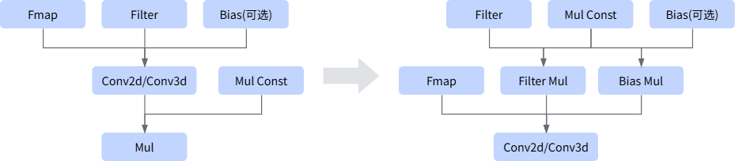

# AConv2dMulFusion

## Fusion Mode

This fusion fuses Conv2d+Mul or Conv3d+Mul into one fused operator Conv.

## Usage Constraints

- The Conv node can be Conv2d or Conv3d.
- The Conv node must have exactly 1 output node, and that output node is Mul; both inputs of the Mul node must have data edges.
- The Mul node must have 1 Const input and 1 non-Const input.
- When Filter, Bias, and the other input of Mul are all Const inputs, the fusion is supported.
- When the Conv node is Conv2d:
    - The convolution output format supports only NCHW or NHWC.
    - The shape of the scale input must be 1D, and the dimension value must be 1 (scalar) or equal to the number C of convolution output channels.
    <!-- npu="950" id8 -->
    - When the output is in NCHW format, channel-wise scale (dimension value equal to C) is not supported. This constraint applies to the following product models:
        <!-- npu="950" id6 -->
        - Ascend 950PR&950DT products
        <!-- end id6 -->
    <!-- end id8 -->
- When the Conv node is Conv3d:
    - Only the NDHWC format of the data input is supported.
    - The Const Mul input of the Mul node must be a 1D input, and the dimension must equal the C dimension of the Conv3d operator output.
    - The Mul node must have exactly 1 output node.
    - The input shape of the scale node cannot be a dynamic shape.

## Supported Models

<!-- npu="310p" id1 -->
Atlas inference products
<!-- end id1 -->

<!-- npu="310b" id2 -->
Atlas 200I/500 A2 inference products
<!-- end id2 -->

<!-- npu="910" id3 -->
Atlas training products
<!-- end id3 -->

<!-- npu="910b" id4 -->
Atlas A2 products
<!-- end id4 -->

<!-- npu="A3" id5 -->
Atlas A3 products
<!-- end id5 -->

<!-- npu="950" id7 -->
Ascend 950PR&950DT products
<!-- end id7 -->
