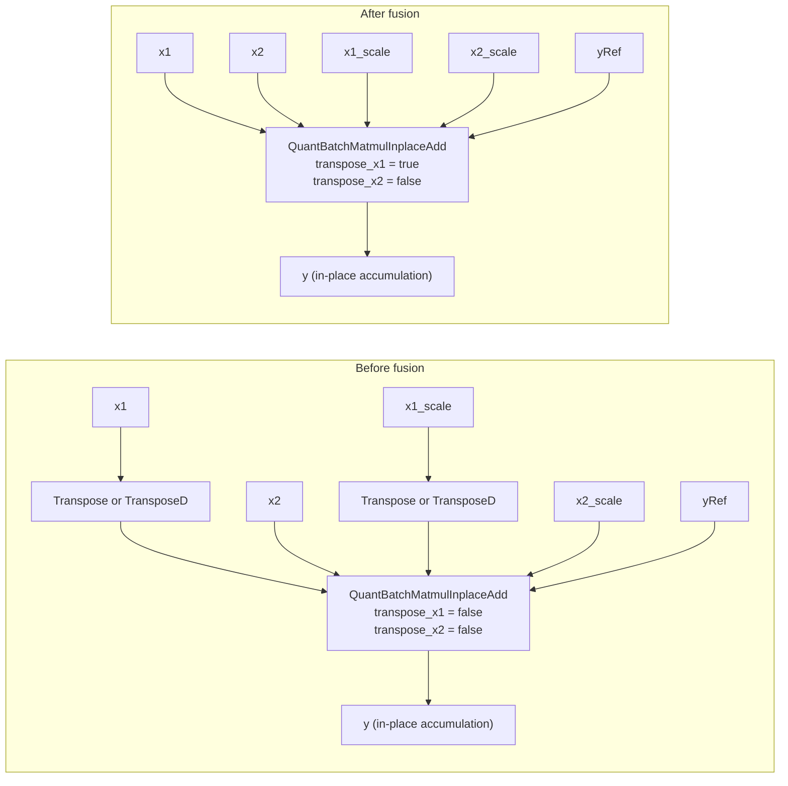
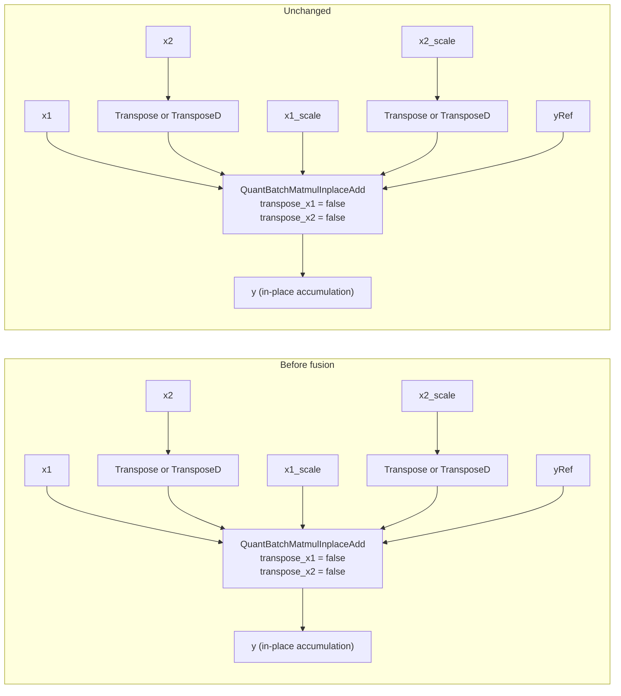
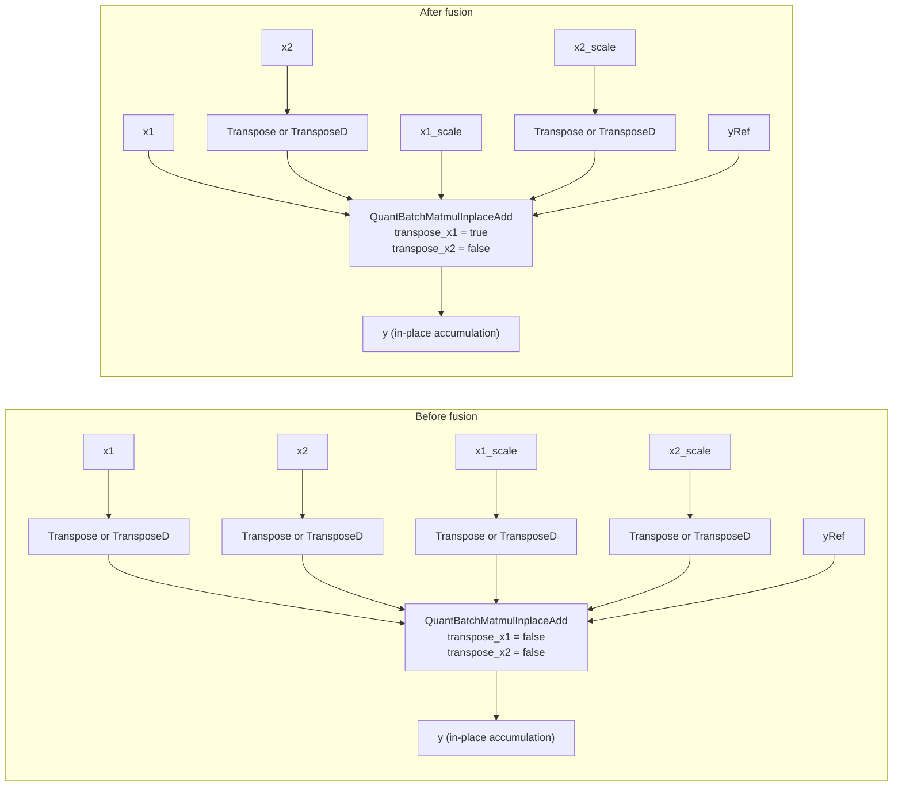
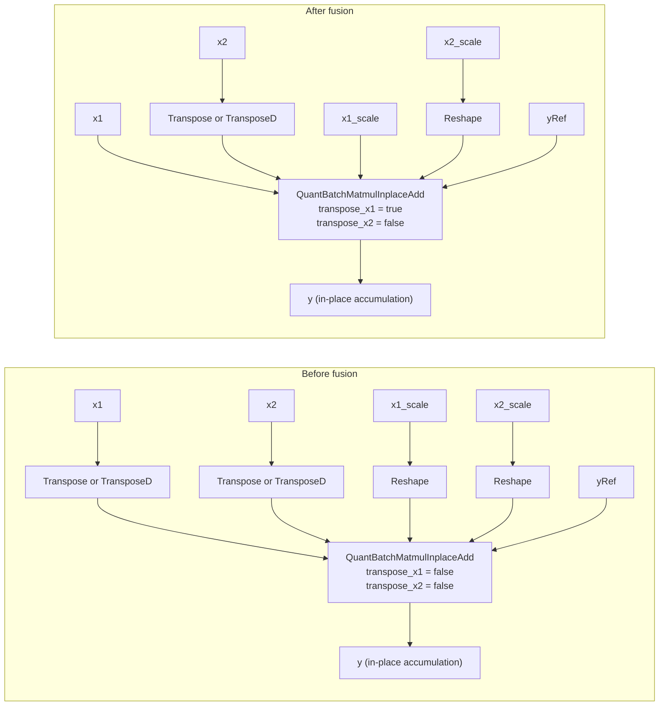
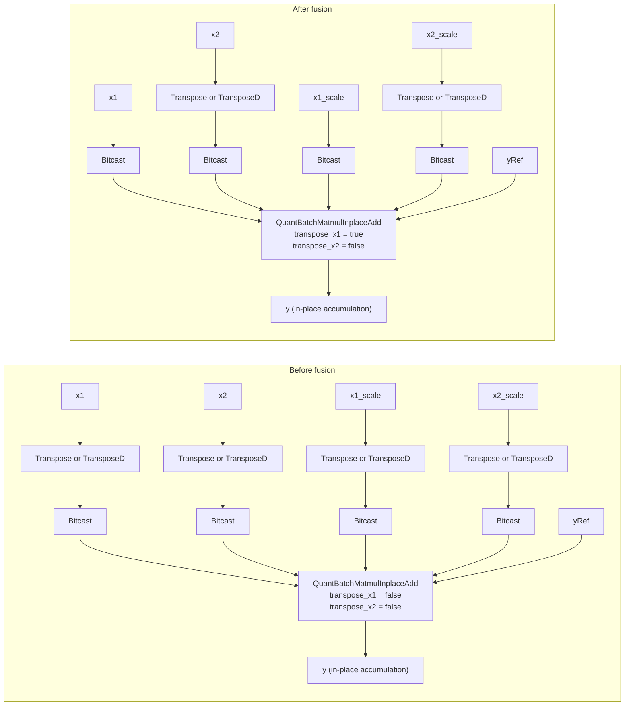
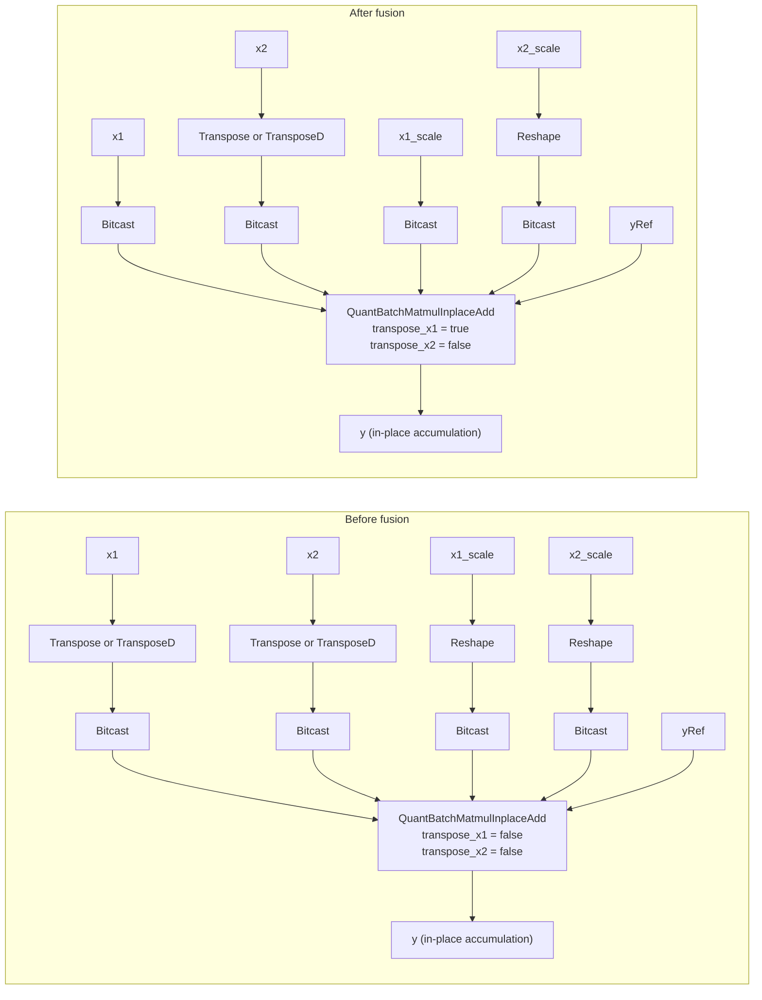
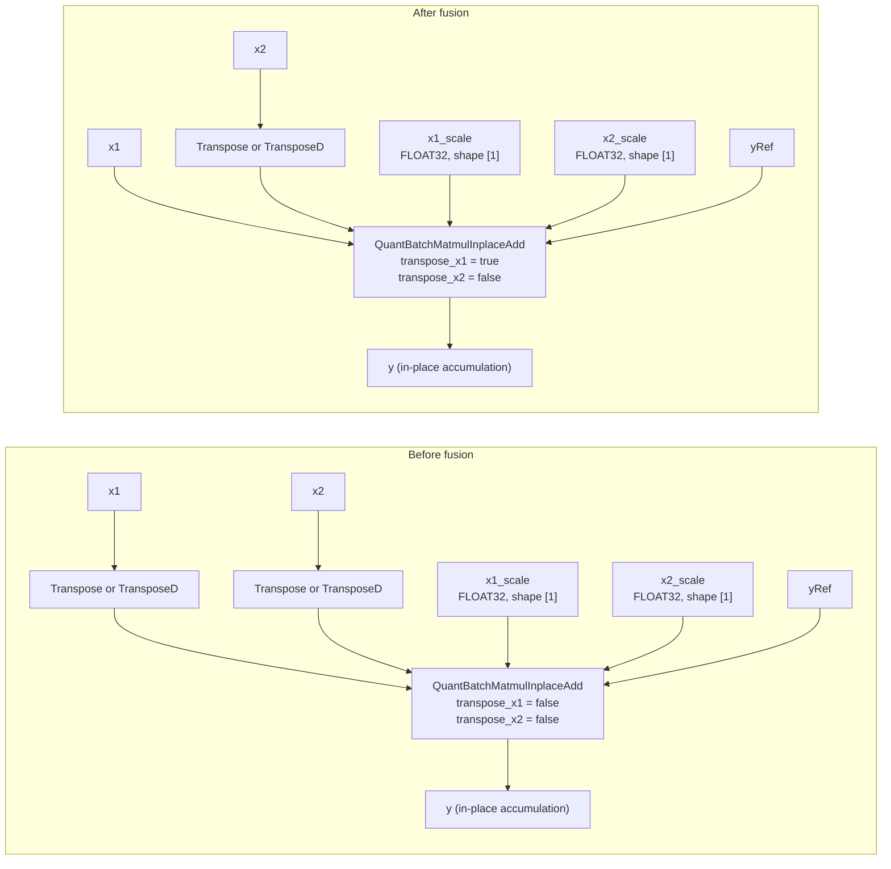
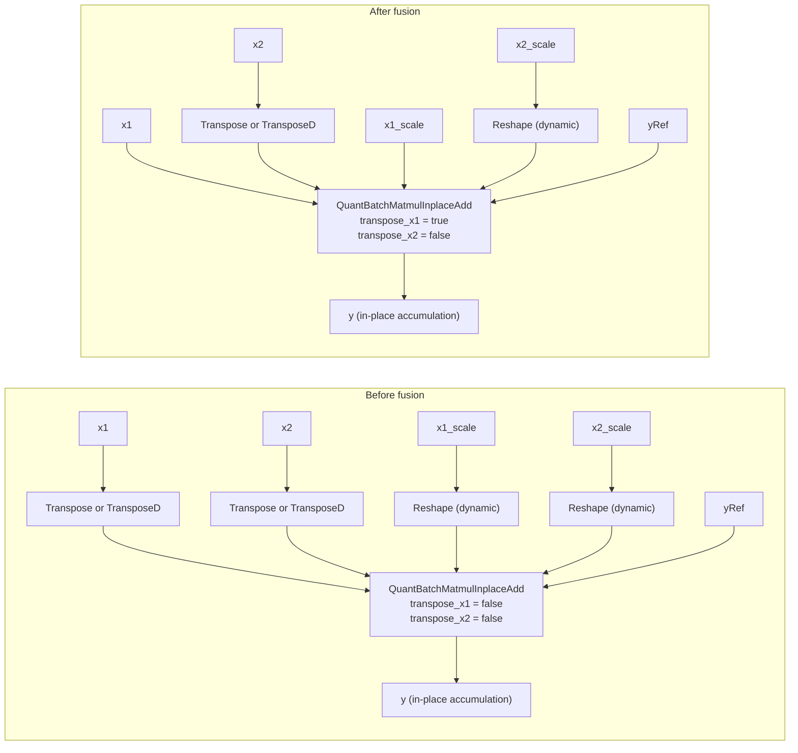
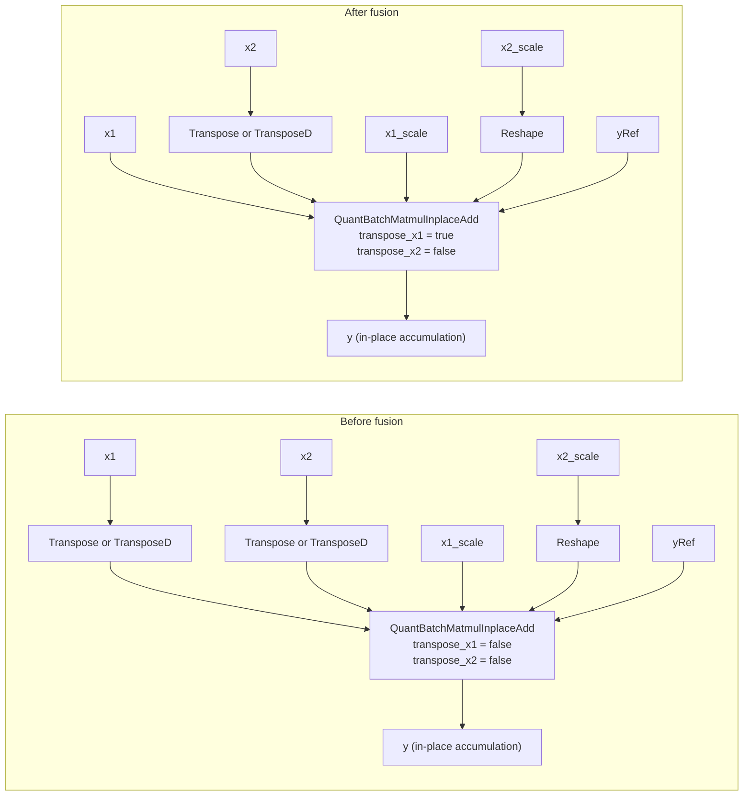

# QuantBatchMatmulInplaceAddTransposeFusionPass

## Fusion Patterns

This fusion rule folds a `Transpose` or `TransposeD` before the `x1` input of `QuantBatchMatmulInplaceAdd` into the operator and negates `transpose_x1`. When the conditions are met, a transpose or equivalent `Reshape` before `x1_scale` is also fused. An intermediate `Bitcast` is preserved. `x2`, `x2_scale`, and `transpose_x2` remain unchanged.

Diagram conventions:

- The inputs are `x1`, `x2`, `x1_scale`, `x2_scale`, and `yRef`. `yRef` is the accumulation input and corresponds to the operator input `y`. Output `y` preserves the in-place accumulation relationship.
- `t1` and `t2` denote `transpose_x1` and `transpose_x2` before fusion, respectively; `!t1` denotes logical negation. This rule applies only when `t1=false` and `t2=false`. After fusion, `transpose_x1=true` and `transpose_x2=false`.
- `M` and `N` are the numbers of rows and columns in the result matrix, and `K` is the reduction dimension of the matrix multiplication. Shapes are shown in square brackets. A singleton dimension has size 1.
- Inputs specifying the transpose permutation and the target Reshape shape are omitted. The diagrams illustrate the transformation; the actual inputs and fused result must satisfy the operator specifications.

### Fusing Only the x1 Transpose

The `Transpose` or `TransposeD` before `x1` is folded into the target operator, negating `transpose_x1`. A qualifying transpose before `x1_scale` is fused at the same time. The connections of `x2` and `x2_scale` are preserved.

### No Fusion When Only x2 Has a Transpose

Transformations only on the `x2` or `x2_scale` branch do not trigger this rule. The graph remains unchanged.

### Fusing Only x1 When Both Sides Have Transposes

When both data inputs have preceding transposes, only the transformations of `x1` and a qualifying `x1_scale` are fused. `Transpose`, `TransposeD`, `Reshape`, and `Bitcast` nodes before `x2` and `x2_scale`, and their connections, are preserved.

### Fusing x1_scale Reshape in MX Quantization

For static shapes, a `Reshape` of a three-dimensional FLOAT8_E8M0 `x1_scale` is treated as an equivalent transpose when it swaps the first two dimensions and at least one of those dimensions has size 1. For example, the shape changes from `[1, M, 2]` to `[M, 1, 2]`. This `Reshape` can be fused together with the `x1` transpose. A `Reshape` before `x2_scale` is preserved.

### Transpose Fusion Retaining Bitcast

For a transpose → `Bitcast` → target operator sequence, the transpose is fused and `Bitcast` is preserved. `x1` and `x1_scale` may each have one `Bitcast`; both branches need not contain one. The `x2` and `x2_scale` branches remain unchanged. For restrictions on shared nodes, see [Usage Constraints](#constraints).

### Fusing x1_scale Reshape While Preserving Bitcast

The `x1_scale` branch may have a `Reshape` → `Bitcast` → target operator sequence. If `Reshape` is equivalent to a transpose and the pattern containing `Bitcast` is recognized, `Reshape` is fused and `Bitcast` is preserved. The diagram shows static-shape MX quantization. For restrictions on dynamic-shape combinations, see [Usage Constraints](#constraints).

### Preserving Connections for Single-Element Scales

For HIFLOAT8 per-tensor quantization, for example, `x1_scale` and `x2_scale` are one-dimensional FLOAT32 tensors of shape `[1]`, each containing one quantization coefficient. If neither scale has a preceding transformation, their connections are preserved and only the `x1` transpose is fused. Here, `[1]` is distinct from the zero-dimensional tensor shape `[]`.

### Fusing x1_scale Reshape with Dynamic Shapes

When a data input shape contains an unknown dimension, a `Reshape` before `x1_scale` can be recognized without the singleton-dimension condition required for static shapes. The input graph must ensure that this `Reshape` is equivalent to the required transpose. The diagram contains no `Bitcast`. This describes a fusion pattern and does not imply support for arbitrary unknown input dimensions.

### Other Reshape Patterns with Singleton Dimensions

For static shapes, a preceding `Reshape` can also be recognized when `x1_scale` has at least two dimensions and at least one of its last two dimensions has size 1, for example, a shape change from `[8, 1]` to `[1, 8]`. The input graph must ensure equivalence to a transpose. The quantization mode and parameter combination must still satisfy the operator specifications.

### No Transformation Before x1_scale

If `x1_scale` connects directly to the target operator, has no recognizable preceding transformation, or is an unconnected optional input, that branch remains unchanged and does not prevent fusion of the `x1` transpose. `x2_scale` must retain a valid input connection.

## Constraints

- Before fusion, `transpose_x1=false` and `transpose_x2=false` are required so that the resulting attributes meet the backend requirements. Other attribute combinations leave the graph unchanged.
- A recognizable `Transpose` or `TransposeD` must precede `x1`, connecting directly to the target operator or through one `Bitcast`. A `Reshape` alone or a transpose only on the `x2` branch cannot trigger this rule.
- Data transposes must match matrix-multiplication transpose semantics, and scale transformations must preserve the correspondence between quantization coefficients and data. Arbitrary dimension permutations or Reshape operations are not equivalent transposes.
- Patterns containing `Bitcast` apply only when the transformation being fused is not shared with another computation branch. Numerical correctness on shared branches is not guaranteed by these patterns.
- Patterns containing `Bitcast` must pass the target platform's capability check. Unsupported platforms leave the graph unchanged. This restriction does not apply to patterns without `Bitcast`.
- Each target node determines whether shapes are dynamic from its own `x1` and `x2` shapes, independently of previously processed nodes or graphs. A dynamic-shape `Reshape` → `Bitcast` combination must still satisfy platform capability and other fusion requirements. Dynamic shape here means a shape with unknown dimensions and is distinct from MX dynamic quantization.
- Data types, quantization modes, shapes, and transpose attributes must satisfy the [QuantBatchMatmulInplaceAdd specifications](../README_en.md). The operator currently requires `transpose_x1=true` and `transpose_x2=false`. Negating the attribute in a diagram does not extend operator support.

## Applicable Products

<!-- npu="950" id1 -->
- <term>Ascend 950PR&950DT products</term>
<!-- end id1 -->
